# THE LAST SEED

**A 60-second pixel-art short film made entirely in code by a team of 14 AI agents.**
No video generator, no image generator, no samples. Every pixel, every frame of animation, every note of the score and every sound effect is Python.

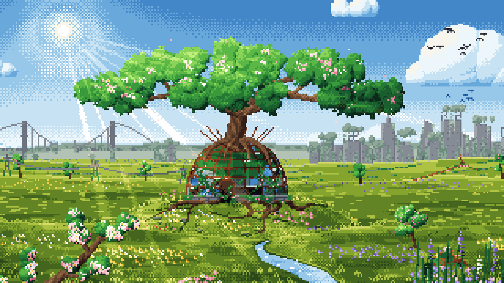

▶️ **Watch the film:** [`film/the_last_seed.mp4`](film/the_last_seed.mp4) (1920×1080, 30 fps, 60 s)
📖 **Read how it was made:** [`docs/behind_the_scenes.pdf`](docs/behind_the_scenes.pdf)
🎵 **Listen to the score:** [`media/score.mp3`](media/score.mp3)

---

## The story

In a dead, grey world, a small rusty gardening robot finds the last living sprout. It carries it across the wasteland, through a sandstorm, to its old ruined greenhouse. At night the dying sprout leans toward the glow of the robot's chest, and the robot understands: its heart is the light the sprout needs. At dawn it plants its own heart beside the sprout. Color floods back into the world.

*Giving your light away is how the world gets its color back.*

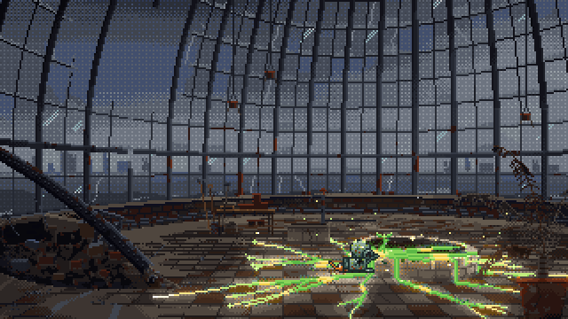

| | | |
|---|---|---|
| 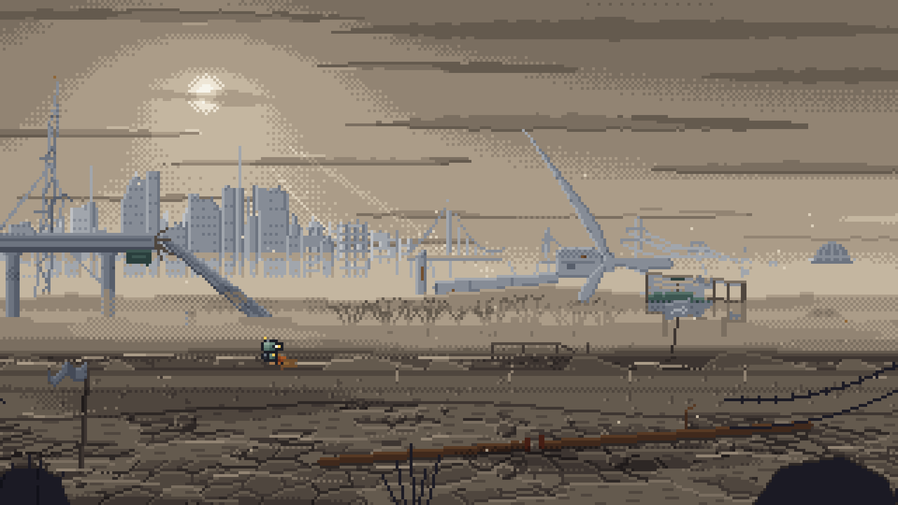 | 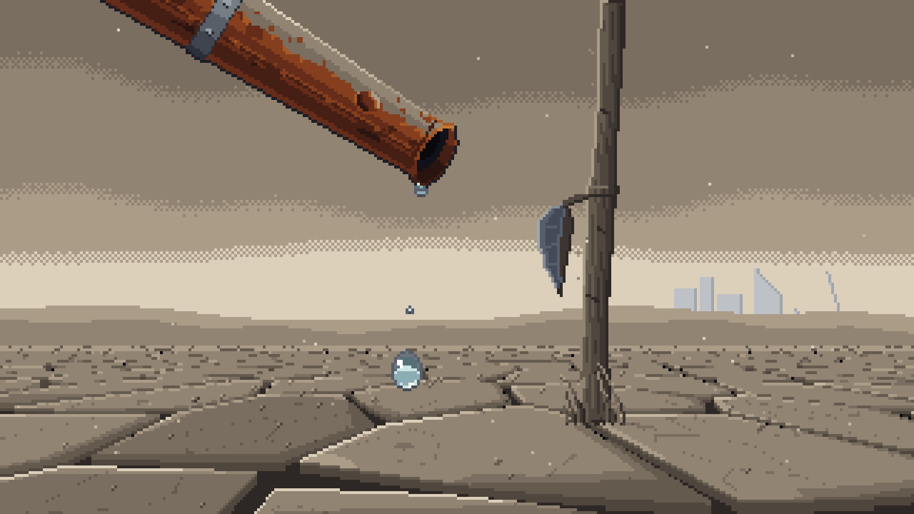 | 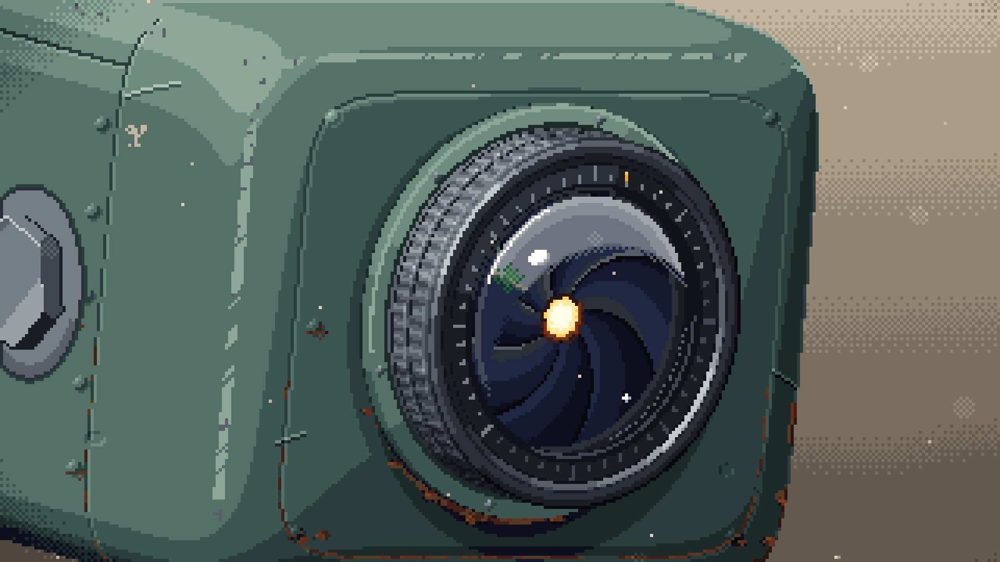 |
| 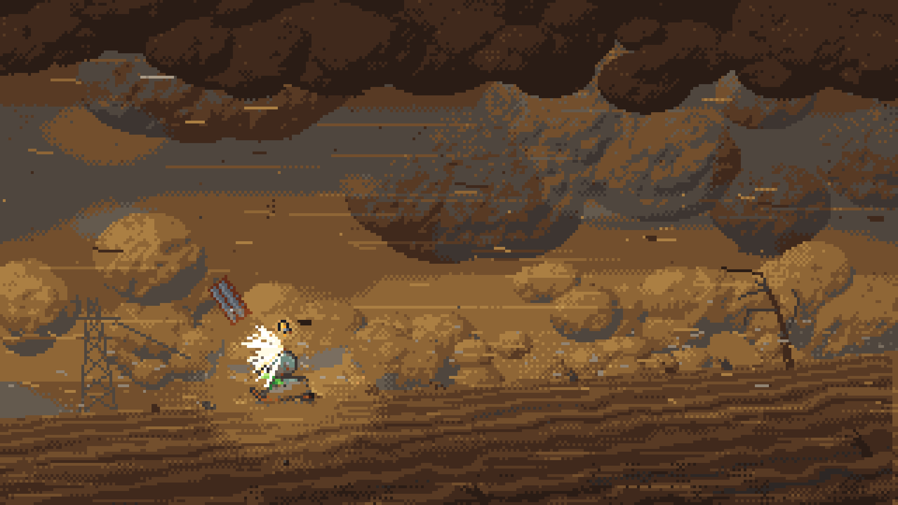 | 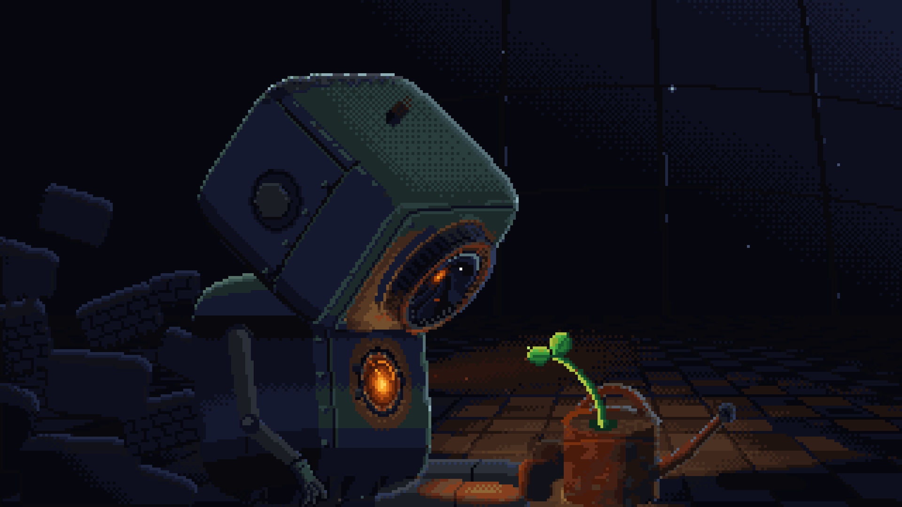 | 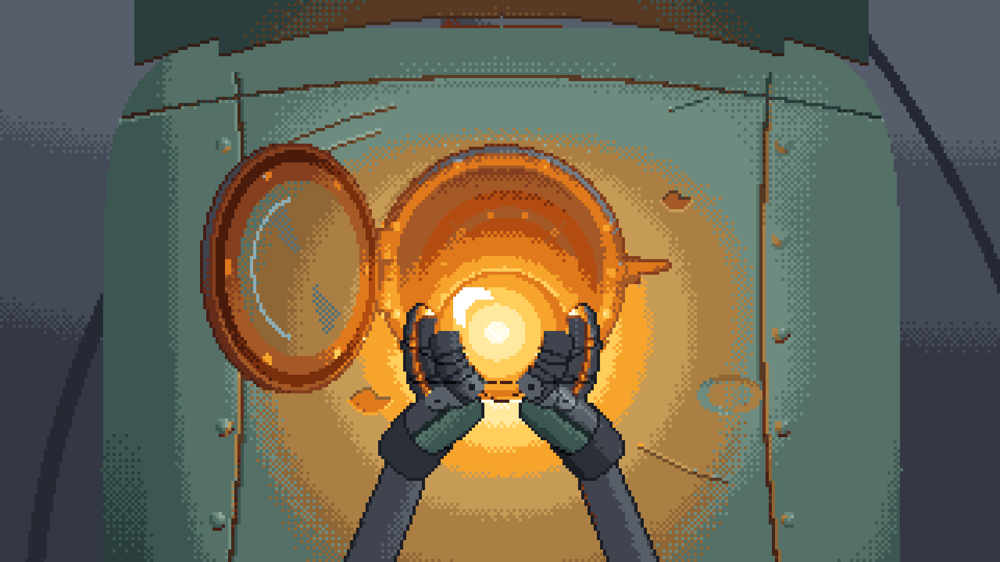 |
| 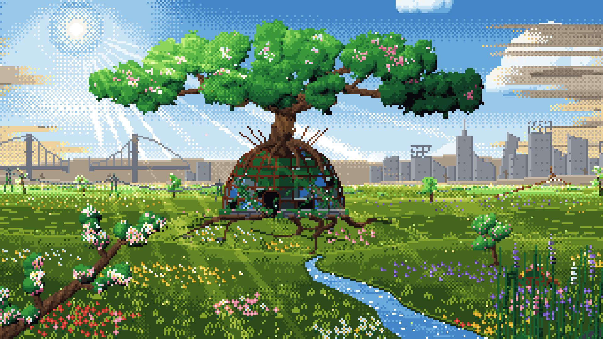 | 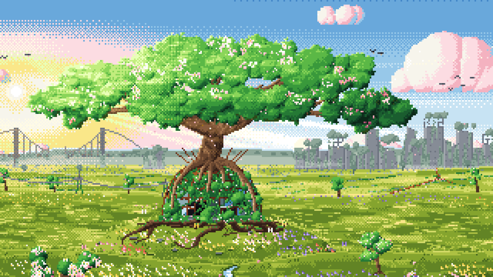 | 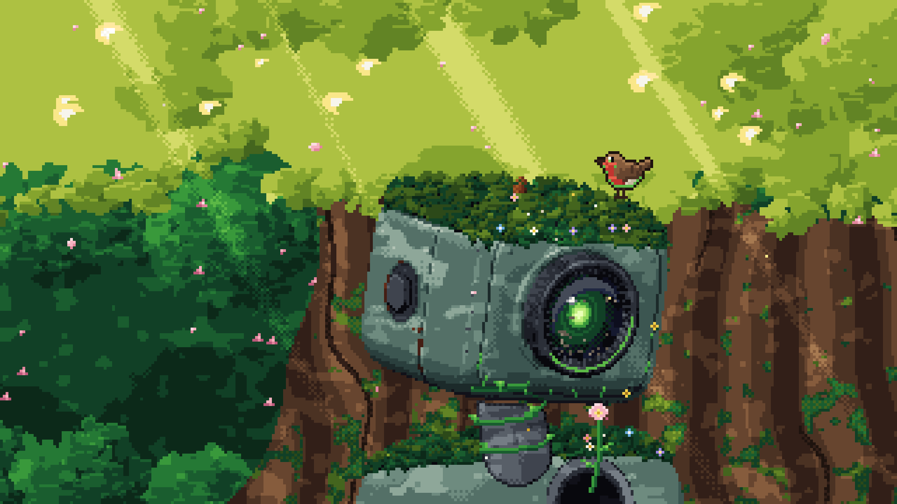 |

## How it was made

1. **Foundations.** A director agent wrote a small pixel-art engine (320×180 canvas shown 6× at 1080p, a 132-color palette organised in ramps, palette-true dithered lighting, sub-pixel parallax), a production bible, a canonical robot model sheet and a master cue sheet.
2. **Parallel production.** Eleven agents worked at the same time, each owning its own files: two character animators, six shot teams, a composer, a sound designer and a title designer. Every agent rendered and looked at its own frames, with at least four critique cycles.
3. **Review.** The first cut revealed the robot was too small at the emotional moments, so close-up inserts were added. A separate **critic agent** then audited all 1,800 frames, every cut and every sync point, and found 21 issues — from a blank frame caused by float rounding to a 4-pixel jitter. Each went back to its owner and was fixed.
4. **Master.** Hue-preserving palette fades, a final mix at −15.6 LUFS, 1080p H.264.

Full story, diagrams and lessons learned: [`docs/behind_the_scenes.pdf`](docs/behind_the_scenes.pdf).

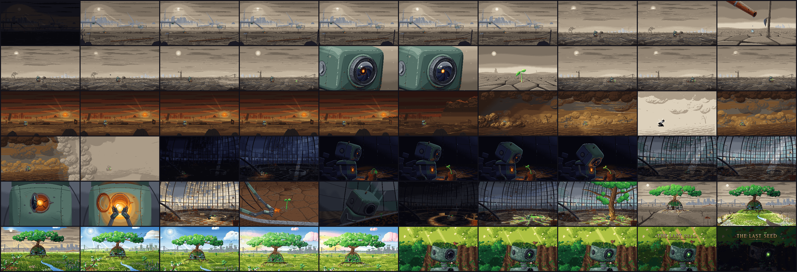

## The team

| Agent | Delivered |
|---|---|
| Director | Story, engine, palette, bible, compositor, edit, mix |
| Character animators ×2 | The robot's full animation set as hand-authored ASCII pixel art |
| Shot teams ×6 | Wasteland, discovery, close-ups, storm, greenhouse, bloom |
| Composer | A fully synthesized score with two themes |
| Sound designer | Ambience, foley and the robot's voice, synced to frames |
| Title designer | Custom pixel font and animated title |
| Inserts artist | The last drop, the heart into the soil |
| Critic | Frame-by-frame audit: 21 issues |
| Close-up polish artist | One canonical robot across every close-up |

## Repository map

```
engine/      the pixel-art engine: palette, dithering, lighting, sprites, particles, sub-pixel stage
chars/       the robot (model sheet + animation rigs) and props
shots/       one module per shot: DURATION + render(t), a pure function of time
audio/       the score (music*.py), the sound design (sfx*.py) and the mix
film.py      the edit: timeline, transitions, title overlay
cues.py      every sync point of picture, music and sound
render.py    contact sheets, previews and the final render
BIBLE.md     the production bible every agent worked from
tools/       review tools written by the agents (sprite sheets, critic scripts, checks)
film/        the finished film
docs/        behind-the-scenes PDF
media/       stills, GIF, contact sheet, score
```

## Render it yourself

```bash
pip install -r requirements.txt          # plus ffmpeg on your PATH
python render.py --sheet --every 1.0     # contact sheets of the whole film -> review/
python -m audio.music                    # synthesize the score   -> audio/music.wav
python audio/sfx.py                      # synthesize the sound   -> audio/sfx.wav
python audio/mix.py                      # mix                    -> audio/mix.wav
python render.py --final                 # the film               -> out/the_last_seed.mp4
python -m engine.preview shots.s05_storm --sheet   # look at any single shot
```

---

Released under the [MIT License](LICENSE).

Directed by **Avitz Meir** · [AvIz - AI for Humans](https://github.com/aviz85) · produced with Claude.
